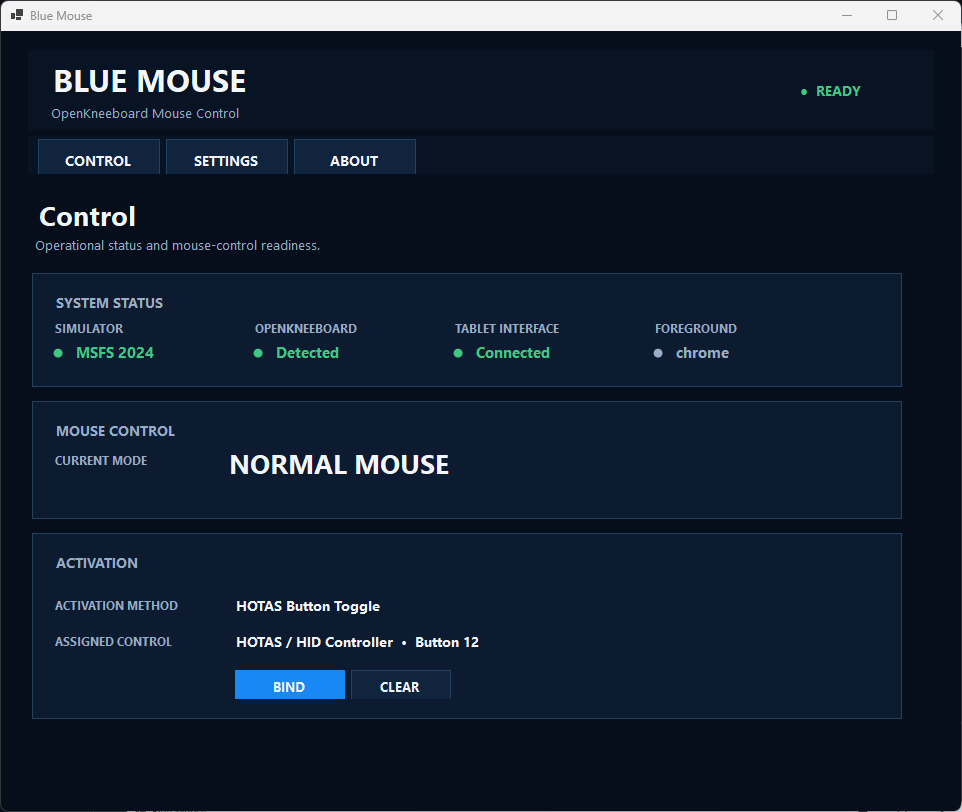
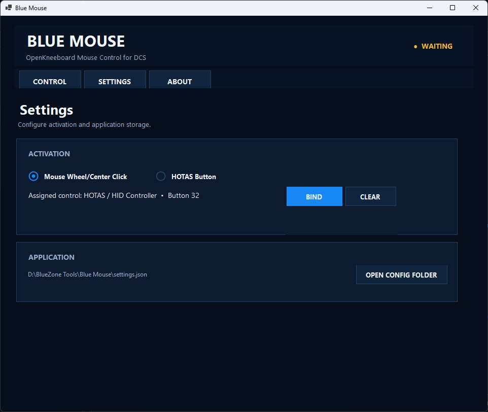
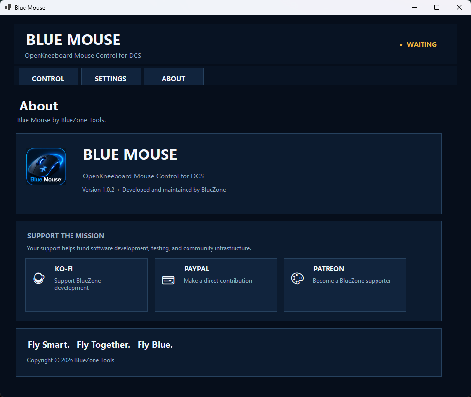

# 🖱️ Blue Mouse

    

> Use your everyday mouse to interact with OpenKneeboard in VR—without switching away from your simulator.

**Blue Mouse** is a lightweight, standalone Windows utility that lets you use your normal desktop mouse to interact with **OpenKneeboard in VR** while keeping your simulator in the foreground.

Originally built for **DCS World**, Blue Mouse now also works with **Microsoft Flight Simulator 2024**. Blue Mouse also recognizes **MSFS 2020** and **iRacing**, but neither has been manually tested; compatibility is not yet confirmed.

Activate Blue Mouse with a middle-mouse click or a bound HOTAS button, move and click inside OpenKneeboard, then deactivate to return mouse control to your simulator. **Blue Mouse 1.0.7 adds right-click support**, manually validated with OpenKneeboard 1.12.14.

---

## ✨ Features

### 🖱️ Mouse Control for OpenKneeboard

Blue Mouse converts normal mouse movement into tablet-style input that OpenKneeboard can use.

While Blue Mouse is active:

- Move the mouse to move the OpenKneeboard pointer
- Left-click to select tabs, buttons, and other OpenKneeboard controls
- Right-click in supported content, including Chromium mouse-emulation pages and Window Capture
- Keep your simulator in the foreground
- Prevent mouse movement and clicks from unintentionally operating your simulator

Deactivate Blue Mouse and your mouse returns to normal simulator operation. Right-click behavior depends on the OpenKneeboard page type; it is not a universal context menu for every tab.

---

## 🎮 HOTAS Activation

Blue Mouse can be activated directly from a joystick, throttle, or other compatible HOTAS device.

No VoiceAttack keyboard mapping is required.

Use **Bind** in Blue Mouse and press the HOTAS button you want to assign.

Your assignment is saved automatically and restored the next time Blue Mouse starts.

This makes it possible to:

1. Keep your headset on
2. Press your assigned HOTAS control
3. Use your normal mouse with OpenKneeboard
4. Press the HOTAS control again
5. Immediately return the mouse to your simulator

---

## 🖱️ Middle Mouse Activation

Don't want to dedicate a HOTAS button?

Blue Mouse can also use the standard **mouse wheel / middle-click button** as the activation control.

Click once to enable OpenKneeboard mouse control.

Click again to return to normal simulator mouse control.

The middle-click activation is intercepted only when Blue Mouse can safely route input to OpenKneeboard.

---

## 🥽 Designed for Simulator VR

Blue Mouse began as a solution for **DCS World with OpenKneeboard in VR** and now supports additional simulators.

Normally, interacting with an overlay while a simulator owns the foreground can be difficult. Blue Mouse routes mouse input to OpenKneeboard without intentionally switching focus away from the active simulator.

**Your simulator remains in the foreground while the mouse controls OpenKneeboard.**

### Simulator compatibility

| Simulator | Status |
| --- | --- |
| DCS World | Manually validated |
| Microsoft Flight Simulator 2024 | Manually validated |
| Microsoft Flight Simulator 2020 | Recognized; not tested |
| iRacing | Recognized; not tested |

Blue Mouse can also operate without recognizing a specific simulator, but compatibility with other applications is not guaranteed.

---

## 🛡️ Mouse Isolation

When Blue Mouse is active and OpenKneeboard is connected, it suppresses the physical mouse input that would otherwise reach the foreground simulator.

This includes:

- Mouse movement
- Left mouse clicks
- Right mouse clicks

When Blue Mouse is deactivated, normal simulator mouse operation is restored.

---

## 🚨 Emergency Release

Blue Mouse includes an emergency release mechanism.

Press:

**ESC**

to immediately release Blue Mouse control and restore normal mouse operation.

Safety mechanisms are also built into the application to release mouse control if the OpenKneeboard connection is lost.

---

## 🔌 OpenKneeboard Integration

Blue Mouse communicates with OpenKneeboard using its tablet-input interface.

Blue Mouse provides OTD-IPC v1 and v2 tablet-input interfaces. **Both protocols can carry right-button input**; OTD-IPC v2 is **not** required for right-click.

**Right-click was manually validated with OpenKneeboard 1.12.14.2922 using OTD-IPC v1 and Blue Mouse 1.0.7.** Other OpenKneeboard versions and page types may behave differently.

Blue Mouse is an independent application. It does not modify OpenKneeboard or require a custom OpenKneeboard build.

No modification to the simulator is required.

For DCS, Blue Mouse does **not** modify:

- DCS program files
- DCS Saved Games files
- `Export.lua`
- DCS input configuration
- DCS rendering
- DCS missions

---

## 🖼️ Screenshots

### Blue Mouse

### Settings

### About

---

## 📦 Installation

### Recommended Installation

1. Open the [**Releases** section](https://github.com/bluexone116/BlueMouse/releases) of this repository.
2. Download the latest:

   `BlueMouse-x.x.x-Setup.exe`

3. Run the installer.
4. Review and accept the EULA.
5. Follow the installation prompts.
6. Launch Blue Mouse.

The installer creates the appropriate BlueZone Tools installation structure and can create Start Menu and optional Desktop shortcuts.

---

## 🗂️ Installation Location

Blue Mouse is designed to install as part of the **BlueZone Tools** collection.

Typical installation:

`C:\BlueZone Tools\Blue Mouse`

If an existing BlueZone Tools directory is found on another supported drive, the installer may use that location.

A custom installation location can also be selected during setup.

---

## 🚀 First Run

After installing Blue Mouse:

1. Start **Blue Mouse**.
2. Start **OpenKneeboard**.
3. Start your simulator (for example, **DCS World** or **MSFS 2024**).
4. Open the Blue Mouse **Settings** page.
5. Select your preferred activation method.

Choose either:

### Mouse Wheel / Middle Click

No configuration is required.

or:

### HOTAS Button

1. Select the HOTAS activation option.
2. Click **Bind**.
3. Press the desired joystick or throttle button.
4. Confirm that Blue Mouse displays the assigned control.

The assignment is saved automatically.

---

## ✈️ Using Blue Mouse

Once your simulator and OpenKneeboard are running:

### Normal Operation

Your mouse controls the simulator normally.

### Activate Blue Mouse

Press your assigned HOTAS button or middle-click the mouse.

Blue Mouse switches to:

**KNEEBOARD MOUSE** (or the equivalent active state shown by your version)

Move the mouse and the OpenKneeboard pointer will respond.

Use the left mouse button to select and interact. Use the right mouse button for context actions in supported OpenKneeboard content.

### Return to Your Simulator

Press your activation control again.

Blue Mouse returns to:

its inactive mouse-control state

Your normal simulator mouse control is restored.

---

## ⚙️ Configuration

Blue Mouse remembers configuration automatically.

Saved settings include items such as:

- Activation method
- HOTAS device
- HOTAS button assignment
- Mouse/tablet calibration
- Sensitivity
- Window position

When possible, Blue Mouse stores its configuration with the application.

If the installation directory cannot be written safely, Blue Mouse can use the user's Local AppData directory instead.

The currently active configuration location can be viewed from within Blue Mouse.

---

## 🔧 Diagnostics

Blue Mouse contains an additional diagnostic interface intended primarily for troubleshooting and development.

Launch Blue Mouse with:

`--diagnostics`

to expose the **Diagnostics** page.

Diagnostic information includes:

- Simulator detection
- OpenKneeboard detection
- Foreground process
- OTD-IPC v1/v2 connection and publishing state
- Physical left/right button state and last successfully sent v2 button mask
- HOTAS/HID information
- Mouse input state
- Virtual tablet state
- Suppressed input events
- Configuration path
- Log information

For normal use, Diagnostics is intentionally hidden.

---

## 🖥️ System Requirements

- 🪟 Windows 10 or Windows 11
- ✈️ A compatible simulator (DCS World and MSFS 2024 manually tested)
- 🥽 OpenKneeboard
- 🖱️ Standard Windows mouse
- 🎮 Optional joystick/HOTAS device
- 🥽 VR headset for the intended use case

Blue Mouse is designed for **OpenKneeboard interaction in VR**. A VR headset is relevant to the primary use case, but simulator compatibility is distinct from the headset connection method.

---

## 🛠️ Built With

Blue Mouse is developed using:

- C#
- .NET 10
- Windows Forms
- Windows Raw Input
- Windows HID APIs
- OpenKneeboard OTD-IPC tablet integration
- Windows low-level input hooks

Blue Mouse does not require a kernel-mode virtual tablet driver.

---

## 🐞 Bug Reports

Found a problem?

When reporting an issue, please include:

- Blue Mouse version
- Windows version
- Simulator name and version
- OpenKneeboard version
- Activation method used
- HOTAS model, if applicable
- Description of the problem
- Steps required to reproduce it
- Screenshots or Blue Mouse logs when available

Please use the repository **Issues** section for bug reports.

---

## 💡 Feature Requests

Ideas and suggestions are welcome.

Blue Mouse was created to make interacting with OpenKneeboard in VR simpler and more natural while keeping the simulator in control of the foreground.

Feature requests can be submitted through the repository **Issues** section.

---

## 📜 License

Blue Mouse is provided under the license/EULA included with the application.

Please review the license terms before installing, redistributing, or modifying the application.

---

## ⚠️ Disclaimer

Blue Mouse is an independent community-developed utility.

It is not affiliated with or endorsed by Eagle Dynamics, Microsoft, iRacing, or the OpenKneeboard project.

DCS World, Microsoft Flight Simulator, iRacing, OpenKneeboard, and associated names and trademarks belong to their respective owners.

Use of this software is at your own risk.

---

## 💙 BlueZone

Blue Mouse is part of the **BlueZone Tools** collection.

BlueZone develops tools and utilities for simulation enthusiasts, pilots, mission creators, server administrators, and communities.

### BlueZone Tools

- 🚀 **Blue Runner** — DCS application launcher and utility manager
- 🖱️ **Blue Mouse** — standalone OpenKneeboard mouse control for VR simulators
- 🧩 **Blue Mods** — DCS modification management
- 📊 **BlueReel** — DCS event logging and analysis
- 🎬 Additional BlueZone utilities and tools

---

## 🤝 Support the Project

Blue Mouse is developed and maintained as a free tool for the simulation community.

Development, testing, documentation, and continued improvements all take time and resources. If Blue Mouse improves your VR experience and you would like to support continued BlueZone development, your contribution is greatly appreciated—but never expected.

### ☕ [Support on Ko-fi](https://ko-fi.com/bluezone116)

### 💙 [Support with PayPal](https://paypal.me/bluezone116)

### 🚀 [Join us on Patreon](https://www.patreon.com/bluezone116)

Every contribution helps support continued development, testing, community infrastructure, and future BlueZone tools.

Thank you for using Blue Mouse and supporting the BlueZone community. ✈️

---

## 🖱️ Mouse to Kneeboard. Back to Flying.

**Activate. Navigate. Left-click. Right-click. Fly.**

🖱️ **Blue Mouse — OpenKneeboard control without leaving your simulator.**
